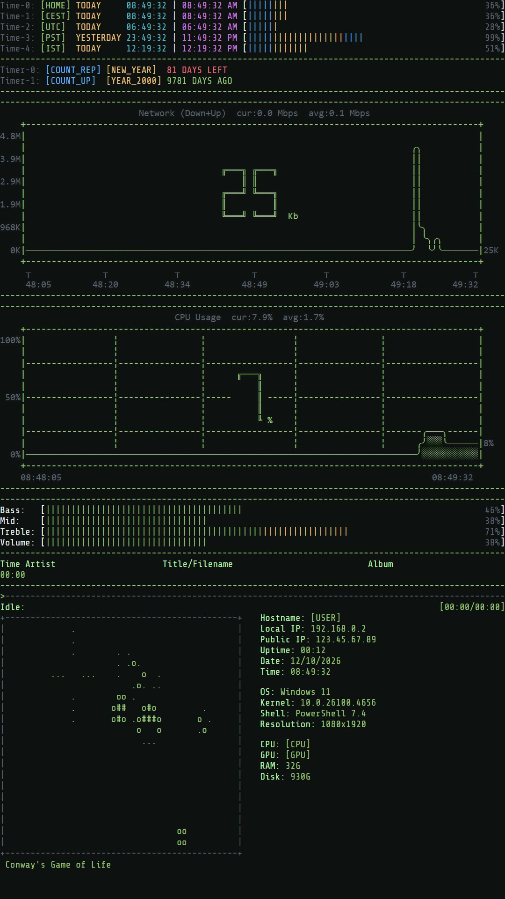

# Living-Terminal

A live terminal-style desktop wallpaper for [Wallpaper Engine](https://www.wallpaperengine.io/). It turns your desktop into a retro terminal dashboard: world clocks, countdown timers, live CPU and network graphs, an audio visualizer, what's playing right now, ASCII art, and a Game of Life that runs while your music is off.

<p align="center"></p>

**Version 1.0.0**

## Features

- **World clocks.** Up to 5 clocks, each with its own label and a day-progress bar. Time zones follow daylight saving time (for example `Europe/Berlin` or `America/Los_Angeles`), and plain hour offsets like `-7` or `5.5` work too. Shows TODAY / YESTERDAY / TOMORROW relative to your own day.
- **Timers.** Up to 5 date timers: count down to a date, count up from a date, or repeat every year (birthdays, holidays).
- **Live graphs.** Network traffic (download + upload) and CPU usage drawn as text graphs, fed by a small local helper. Without the helper they show sample data.
- **Audio visualizer.** Volume, bass, mid and treble bars that react to whatever your PC is playing, with adjustable smoothness and sensitivity.
- **Now playing.** Artist, title, album, a seekbar and the playback time from Windows media playback (Spotify, browsers, media players).
- **ASCII art.** The current album cover, or your own logo, converted to ASCII art in theme colors or the image's own colors.
- **Conway's Game of Life.** Runs in the art panel while no music is playing. It wakes itself up whenever the board gets stuck.
- **System information.** Hostname, local and public IP, uptime, date and time, OS, kernel, shell, resolution, CPU, GPU, RAM and disk, plus up to 11 rows of your own.
- **Fully customizable.** Dark, Light and Custom themes with a full 16-color palette, font size, layout direction and position, panel order, custom margins, and colors for almost every element.

## Installation

1. Copy this folder into Wallpaper Engine's projects folder:
   `...\steamapps\common\wallpaper_engine\projects\myprojects\`
2. Restart Wallpaper Engine. **Living-Terminal** appears under **Installed**.
3. Select it and adjust it from the settings panel on the right.

### Live CPU and network graphs (optional)

The graphs read real data from a tiny local helper that needs [Node.js](https://nodejs.org/).

- Run `tools\install-autostart.cmd` once. It starts the helper now and with every Windows login, hidden in the background.
- Run `tools\uninstall-autostart.cmd` to stop it and remove it from startup.

Wallpaper Engine can't start programs itself, so this step is needed for real data. Details: [tools/METRICS_HELPER.md](tools/METRICS_HELPER.md).

## Settings

| Group | What you can change |
|---|---|
| **Theme** | Dark, Light or Custom theme; background, text and all 16 terminal colors |
| **Layout** | Vertical or horizontal layout, position, alignment, panel order, where the audio panel sits, custom margins, the "terminal too big" warning |
| **Appearance** | Accent color and font size |
| **Times** | Date and time format, 5 clocks with labels and time zones, divider lines |
| **Timers** | 5 timers with labels and dates |
| **Graphs** | Show or hide, graph heights and spacing, divider lines |
| **Audio & Media** | Show or hide, extra bars, smoothness, sensitivity, seekbar character |
| **ASCII Art** | Resolution, album art or your own logo, colors, saturation, background |
| **System Information** | Values to show, plus up to 11 custom rows |

Every group with colors has a **Customize Colors** switch, so the colors stay out of the way until you need them.

**Tip:** to keep everything above the Windows taskbar, turn on **Layout → Custom Margins** and set **Bottom** to about `48` px (or `72` px with 150% display scaling).

## Project structure

```
index.html          the page
global.css          fonts, theme colors, base styles
style.css           layout and component styles
js/                 one script per feature (clocks, timers, graphs, audio, media, ascii, life, ...)
project.json        Wallpaper Engine metadata and settings menu (generated)
tools/
  menu.config.js    the settings menu definition
  build-menu.js     builds the menu into project.json
  metrics-helper.js local CPU/network data for the graphs
  *.cmd, *.vbs      helper launcher and autostart scripts
fonts/              Share Tech Mono and Fira Code (SIL Open Font License)
```

## Development

There is no build step for the wallpaper itself: edit the files and reload the wallpaper in Wallpaper Engine. `index.html` also opens in a normal Chromium browser for quick testing.

### Changing the settings menu

The menu in `project.json` is generated, so don't edit `general.properties` by hand.

1. Edit `tools/menu.config.js`. Groups and settings appear in the order listed.
2. Run `node tools/build-menu.js`.
3. Reload the wallpaper.

- **Never rename or remove a setting key.** Wallpaper Engine stores your saved values by key. The build stops if a key disappears, unless it is listed in `removedKeys`.
- A new color setting also needs an entry in `js/color-map.js`. The build checks that both match.
- If Wallpaper Engine's editor reorders `project.json`, run the build again.

`CATEGORY_ORDER_REFERENCE.md` is regenerated by the build and lists every setting.

## Credits

- Fonts: [Share Tech Mono](https://fonts.google.com/specimen/Share+Tech+Mono) by Carrois Type Design and [Fira Code](https://github.com/tonsky/FiraCode) by The Fira Code Project Authors, both under the SIL Open Font License 1.1.
